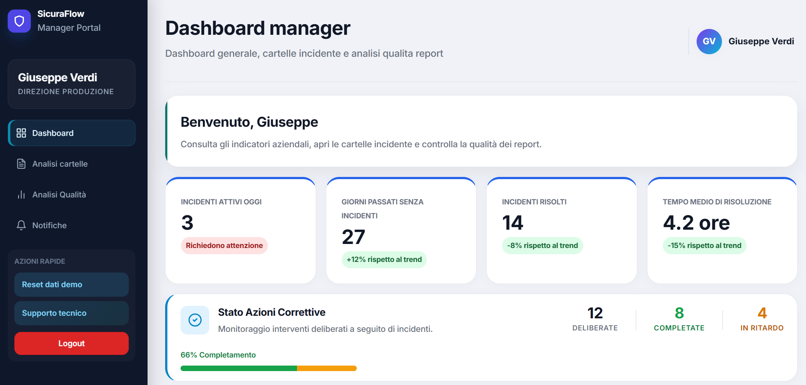
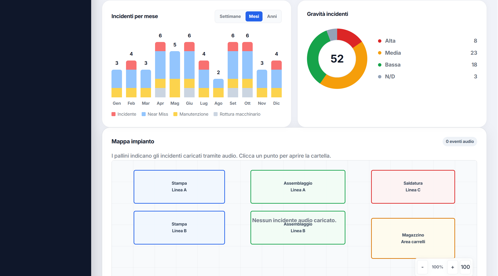

# AI Industrial Incident Reporting





Academic project for the **Smart Factory** course at Sapienza University of Rome, focused on turning audio accounts of industrial incidents into structured reports using artificial intelligence.

The repository covers two stages of the work: an experimental Jupyter pipeline for extracting and merging information, and an extended version with quality analysis and a web interface, **SicuraFlow**.

## Objective

Organize information from accounts given by operators, line supervisors, and safety officers into a shared structure for comparing testimonies and documenting an incident. The project combines audio analysis with Gemini, prompt design, a shared information schema, and Excel export.

## Projects

| Project | Contents | Documentation |
|---|---|---|
| **PROJECT_1** | Individual audio analysis, testimony merging, and Excel reports in notebook 3.3. | [PROJECT_1 README](PROJECT_1/README.md) |
| **PROJECT_2** | Notebook 4.4 with repeated extractions and quality metrics; the SicuraFlow web app for incident reporting, browsing, and chatbot queries. | [PROJECT_2 README](PROJECT_2/README.md) |

## Repository structure

```text
ai-industrial-incident-reporting/
├── README.md
├── .gitignore
├── PROJECT_1/
│   ├── README.md
│   └── script_finale 3.3 .ipynb
└── PROJECT_2/
    ├── README.md
    ├── script_finale_4.4.ipynb
    └── Webapp/
        ├── server.py
        ├── index.html
        ├── requirements.txt
        ├── avvia_app.bat
        ├── GUIDA_AVVIO_E_USO.md
        └── backend/
            ├── __init__.py
            └── pipeline_adapter.py
```

The `output_report/` and `temp_audio/` directories are created during use and excluded from version control.

## Processing workflow

```text
Audio testimonies
        ↓
Gemini analysis and information extraction
        ↓
Structured report for each testimony
        ↓
Merging reports about the same incident
        ↓
Browsing, comparison, and export
```

In the notebooks, extraction takes audio files directly as input. In the web app, processing starts with transcription and analysis of the account, followed by JSON report extraction. Merging makes a new Gemini call using the reports already produced.

## Extracted information

The shared schema contains six sections:

| Section | Main information |
|---|---|
| Incident | Date, type, severity, prior circumstances, trigger, and sequence of events. |
| Locations and equipment | Department, area, machinery, and environmental conditions. |
| Cause analysis | Technical causes, human and environmental factors, and root cause. |
| Consequences | Injuries, material damage, and production downtime. |
| Corrective actions | Procedures, PPE, interventions, responsible parties, and deadlines. |
| People involved | Role, involvement, harm suffered, and testimony notes. |

## Technologies

- **Python and Jupyter** for the notebooks and experimentation.
- **Gemini**, configured in the code with the `gemini-2.5-flash` model, through `google-generativeai`.
- **pandas and openpyxl** for preparing and formatting Excel reports.
- **scikit-learn and SciPy** among the PROJECT_2 notebook dependencies.
- **FastAPI and Uvicorn** for the web app backend.
- **HTML, CSS, and JavaScript** for the interface; `localStorage` for browser storage.

## Getting started

To explore the basic pipeline, open the [PROJECT_1 README](PROJECT_1/README.md). To use quality analysis or run SicuraFlow, follow the [PROJECT_2 README](PROJECT_2/README.md).

You need Python, an Internet connection for Gemini calls, and a personal API key in the `GEMINI_API_KEY` variable. The notebooks also require a Jupyter environment and the audio files specified in their configuration: the example audio files referenced in the code are not included in the repository.

The web app loads its configuration from `PROJECT_2/Webapp/.env`; the notebooks read the process environment variable. Each project's README provides installation and startup commands.

## Interpreting the results

This project is an academic prototype. Reports may include model-generated inferences and suggestions and require review before use. Metrics based on comparisons between extractions describe their consistency; evaluating accuracy requires verified references. The notebook and web app implement metrics differently, as described in the PROJECT_2 README.

The web app uses demo profiles and stores its records in the browser. Files such as `.env`, virtual environments, caches, temporary audio, and generated reports are excluded through `.gitignore`; keys embedded directly in code or notebook outputs are not covered by these exclusions.
